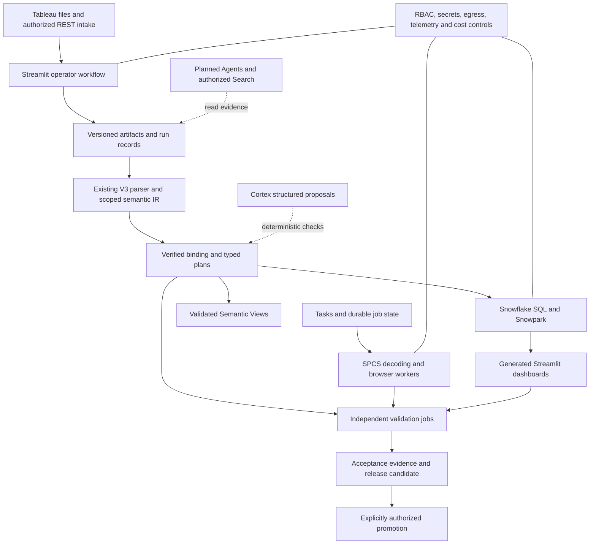

## Current original presentation restoration — 3 October 2026

Build `5fb9bb1a599814f452034421a14a704f627ac9caac309f0a078d9b5c43b1039f` is deployed to the existing V3 target. All 52 runtime hashes match; access and runtime settings match the previous deployment. Verified rollback: preceding build e68c5e8b7f43434e6db32abfbeac5d7790a26fed54d92f1fd95a65f5a27541a2 in this checkpoint's deployment/rollback_live. This supersedes the previous layout/readiness entry below.

DEMO-LAYOUT-05 IMPLEMENTED_AND_VERIFIED_SCOPED. User supplied the original deployed ECommerce migration screenshot. Inspected the actual original app package read-only, not only the newer parent renderer. Its simple KPI cards use native st.metric and signed badges; its rank tables use headers and rank numbers. The V3 customized-label and scoped rank paths bypassed that presentation. V3 now explicitly reuses those original presentation functions on validated scoped data, with large adaptive KPI values, compact visible-axis sparklines and ranked table headers. Complex label compositions retain their authored renderer. 'Open dashboard' opens a clean selected-view dashboard; 'Back to migration workspace' returns to the same Cloud intake and Cortex assessment. Underlined navigation keeps lazy selected-view execution. Controls remain explicit Streamlit interaction adaptations. Source calculations, joins and field identity remain authoritative; no workbook-name dispatch or model-generated execution was added.

Fixed percent direction formatting: a source negative gate may return ABS(delta)>0 with a literal down-arrow pattern; its authored arrow is now retained. Ordinary signed percentages keep their sign. Missing prior-period percentages display an em dash rather than nan%. Parameter widgets avoid supplying a competing default when reset has populated session state; inherited headless widget mocks remain compatible. The focused dashboard saves the intake widget values in a durable non-widget snapshot and restores them in the Back callback, protecting the selected source, site, project and workbook from hidden-widget cleanup. Snowflake binding inputs also defer to restored state without supplying a competing default; empty inputs remain supported.

Fresh checks PASS: inherited regression and 273 V3 tests. Numerical/corpus evidence from the freshly checked e68 source build in return_final is carried forward with explicit provenance: 72 SALES executions, all 50 ECommerce output occurrences, 42 Main filter states, 120 Product metric/filter comparisons and 13 member/Details comparisons. The final package requires every runtime file except v3_app.py to match that build byte-for-byte; the final edit changes only the Snowflake binding input default. Additional independent extract checks confirm quantity 10694 vs 10787 (−0.9%) and all 21 Days sparkline points plus the 66.662959 KPI, and 72 value/change checks for 36 category rows across all 12 rank cards. The three authored Avg. Days rank cards display AOV values with Days-to-second-purchase changes; the reference checks both fields independently. The earlier incorrect AOV-change reference attempt is preserved under reset_final/rank_numeric_oracle_aov_delta_assumption.json. Corpus: 25 files, zero structural errors, 132 unsupported-invalid occurrences; this is not 25 accepted workbooks. Evidence: reports/original_presentation_20261002/binding_final/release_gates.json, numeric_provenance.json, presentation_numeric_oracle.json, rank_numeric_oracle.json, deployment/verification.json, hosted_ui.json and source_freeze.json.

The original app embeds 'E-Commerce (Software) Sales Dashboard #VOTD.twbx'; V3's demo uses 'ECommerce_Live_Relationship_Events_Customers_Products.twbx'. Presentation is the baseline, not independent numeric ground truth. V3's Days sparkline has independently verified full customer-history values; its daily range differs from the original screenshot. Source-authored three Avg. Days rank cards continue to display AOV per user direction. Exact Tableau pixel/whole-workbook acceptance remains NOT_VERIFIED. Broader enterprise/holdout/validated AI repair, installation, isolation, cost and shape/Gantt acceptance gaps remain open. Hosted Cloud intake still demonstrates actual Cortex structural assessment, not AI-generated renderer repair. Scoped standalone exports now use the same restored presentation; compound authored labels remain preserved.

Next: review this deployed view against the supplied original screenshot, rehearse the updated 30-minute route, and obtain a working matching Tableau reference for exact visual/interaction acceptance. Current demo route: Cloud intake → Cortex assessment → Open dashboard → Dashboard/Details/Product and resets → Back to migration workspace. The updated eight-slide deck and current runbooks identify 273 tests and the new dashboard route.

---

## Current layout fidelity correction — 2 October 2026

User reported that the preceding demo build's ECommerce cards did not match Tableau's layout. That report supersedes its broad layout-readability claim. Build `cced4899775afb6177271db18f28234a50b6373478ddc5c2ffb2d22846d9e8fc` is now deployed to the existing V3 target; 52 runtime hashes match, settings/grants unchanged, preceding runtime backed up.

DEMO-LAYOUT-04 IMPLEMENTED_AND_VERIFIED_SCOPED. Inspected original renderer and authored XML. Generic parser now retains the fixed canvas dimensions; temporal charts honor authored height, hidden axes and absent legends; KPI labels preserve all styled values while fitting nonempty lines to the authored zone; desktop columns retain authored proportions; action filters open in compact popovers. These repairs are deterministic, not AI-generated. Original/V2 preserved. Source-authored Avg. Days/AOV behavior unchanged.

Fresh gates PASS: inherited regression, 263 V3 tests, 72 SALES executions, 50 ECommerce output occurrences, 42 Main states, 120 Product metric/filter comparisons, 13 member/Details comparisons. Corpus remains 25 files / zero structural errors / 132 unsupported-invalid occurrences, not 25 accepted workbooks. Evidence in `reports/layout_fidelity_20261002/final`: release_gates.json, deployment/verification.json, hosted_ui.json, source_freeze.json.

Hosted before/after comparison uses the same seven-day state and desktop viewport. Card height, chart width, axes/legend suppression and live popover filtering/reset are recorded in hosted_ui.json. Hosted inspection additionally found Streamlit's negative markdown margin overlapping Product KPI values; the generic KPI selector neutralizes this margin, and parameter button columns have a 120px minimum. Streamlit controls are an explicit interaction adaptation. Exact pixel/whole-workbook Tableau acceptance remains NOT_VERIFIED without a working Tableau reference or matching screenshot. Native shape/Gantt adaptations and the broader enterprise/AI repair/holdout/isolation/installation/cost gaps stay open. Follow-up observations outside this layout correction: a single-day filter can display 'nan%' for missing prior-period rank deltas, and reset can emit a Streamlit default/session-state warning despite restoring correct numeric defaults. Keep these presentation issues open rather than claim all demo behavior perfect.

Next: review the corrected ECommerce appearance against the Tableau reference and rehearse the confirmed 30-minute demo. Current runbooks include opening 'Filter dashboard by…' popovers. Prior slide/checkpoint test totals describe preceding evidence; current release has 263 tests. Continue improving fidelity on reported source differences without workbook-name branches.

---

## Current verified demo freeze — 2 October 2026

Build `eabcd1c8cf341f698c24b250fe8c192990230af39fbd20a489f3d884ac38fdcd` is deployed to the existing V3 target. All 52 runtime hashes match; permissions and runtime settings are unchanged; the preceding runtime is backed up. This checkpoint supersedes the historical in-progress entries below. Original/V2 and concurrent edits are preserved.

DEMO-ECOM-02.3 and the navigation/reset/shared-parameter/layout corrections are IMPLEMENTED_AND_VERIFIED_SCOPED. The 15 Product/Details occurrences are restored through generic bounded plans reusing original aggregation, calculation and formatting code. All 50 ECommerce occurrences produce output. Normal and action parameters remain shared across views; reset restores source defaults and clears filter chips. Container-width wrapping fixes nested control labels even on desktop. Source-authored Avg. Days/AOV behavior is preserved per user direction.

Fresh final gates PASS: inherited regression, 258 V3 tests, 72 SALES executions, 42 ECommerce Main states, 120 Product metric/filter comparisons and 13 member/Details comparisons. Corpus: 25 files, zero structural errors, 132 unsupported/invalid occurrences. This is a structural corpus check, not 25 accepted workbooks.

Hosted evidence verifies the SALES default/USA/reset/January sequence, ECommerce date/category/metric sharing, product and country selection, reset defaults, and readable desktop/narrow layouts. Both exact Cloud intakes automatically bind existing Snowflake data and make one actual Cortex migration review call. Cortex recommends migration checks; these deterministic renderer repairs are not represented as AI-generated repair. Evidence: `reports/product_details_20261002/layout_final/release_gates.json`, `deployment/verification.json`, `hosted_ui.json`, `source_freeze.json`.

Next dependency-ready action: rehearse the frozen build for the confirmed 30-minute Snowflake partner slot (25-minute walkthrough plus five-minute Q&A). Demo materials are in the authorized workspace `demo_monday_20261005/output`: Snowflake_partner_demo_30min_verified.pptx, Demo_talkthrough_30min.txt and Demo_rehearsal_runbook_30min.txt. No new implementation is required for the checked demo flow.

Whole-workbook Tableau visual/interaction acceptance remains NOT_VERIFIED because the published ECommerce Tableau reference is disconnected. Native controls/member tables adapt custom shape/Gantt decorations; exact mark-click and tied-record order equivalence are not claimed. Parent enterprise gaps stay OPEN, including broader validated AI repair, five-workbook/holdout acceptance, tenant isolation, installation and cost/quality acceptance. Show/Hide assigns the authored parameter; pane visibility targets were not established. Local uploaded-file intake has not been accepted through the hosted browser; the exact Cloud path is the verified demo path.

---

# Current AI adoption scope — 2026-09-27

## Current documentation authority

For the enterprise objective and current implementation state, read [V3_ENTERPRISE_HANDOVER.md](V3_ENTERPRISE_HANDOVER.md), [V3_STATUS.md](V3_STATUS.md), [V3_NEXT_IMPLEMENTATION.md](V3_NEXT_IMPLEMENTATION.md) and [V3_ENTERPRISE_FIX_TRACKER.md](V3_ENTERPRISE_FIX_TRACKER.md). This file retains feature details and dated checkpoint history. Older current/next/latest headings below are historical and do not override those canonical documents. Technical constraints remain applicable unless explicitly superseded by verified implementation. No product readiness claim follows from this documentation update.

## AI03.1 INCLUDE planning verified and deployed — 2026-10-01

Supersedes prior next-action/deployed-build statements below. AI03.1 (E05/E12; AI00/AI08,
E08/E25): IMPLEMENTED_AWAITING_EVIDENCE for bounded planning only. New include_lod_plan.py
independently parses physical INCLUDE keys, DAY/MONTH/YEAR of physical dates, supported
row arithmetic and SUM/AVG/MIN/MAX at two aggregation levels. Cortex proposes an array
plan; exact source-derived comparison rejects wrong structures/semantics. The unfiltered
two-stage compiler is an evaluation facility, NOT a worksheet executor. Intake shares
the existing total Cortex budget and displays a separate AI calculation planning panel.
Sheet support/acceptance is never promoted by a validated plan.

Verification: baseline/final inherited regression PASS; 157 V3 tests PASS; four same-byte
original/V3 parser comparisons completed (existing datasource_id/support differences
recorded, NOT JSON equality). Corpus remains JSON-identical: 25 files, zero structural
errors, 336 unsupported/invalid occurrences. Two live synthetic Cortex plans matched
independent ASTs; Snowflake two-stage results 7 and 14 matched independent expectations.
An initial object-shaped model response was rejected; prompt clarified to require the
array grammar, without relaxing validators. Missing inherited package entries were
reproduced and corrected in V3 snowflake.yml. Four live synthetic attempts total across
the initial failure, diagnostic and final two cases; zero production metadata calls.

Authorized deployment PASS to existing V3 target: `0d3d18783509c14a79392f3b63dab040f6e595599efb0e371861f7a24b7b0cee`.
All 38 content hashes match; prior 40 live files backed up; runtime/grants unchanged;
refreshed browser startup PASS. Prior E18.1a/AI00.1c changes retained. Tokens/cost,
production numeric/visual parity and whole-workbook acceptance remain unverified.
The two Online Retail INCLUDE sheets still refuse parameter-driven calculated dates
and nested/conditional dependencies. R00/AI00/AI08 remain IN_PROGRESS; E01-E28 remain
OPEN. Effort unmeasured; remaining estimates RE-ESTIMATION_PENDING.

Next: AI03.2 / E05-E06 implement typed transitive numeric-condition/date/parameter
dependencies, then the filtered KPI binding/execution adapter and independent numeric
references. Do not connect compile_unfiltered_sql directly to production rendering.
E18.1b remains open; LAST/LOOKUP still need E07 addressing/order contracts.
See [checkpoint](reports/ai03_1_20261001/checkpoint.md) and
[V3_INCLUDE_LOD_PLANNING.md](V3_INCLUDE_LOD_PLANNING.md).

## E18.1a verified and deployed — 2026-10-01

This checkpoint supersedes earlier local-only/deployed-build statements below.
E18.1a (E18; related E08/E25): IMPLEMENTED_AWAITING_EVIDENCE. Crosstabs now accept
a nonempty explicit ASC manual prefix with exactly one unlisted measure; malformed
sort dictionaries/options refuse before queries. Multiple unlisted measures still
require a proven remainder-order contract. The two Sales tables remain refused;
no workbook support gain or Tableau parity is claimed. Existing complete manual
orders and independent occurrence identities are preserved.

Verification: inherited regression PASS before/after; 150 V3 tests PASS; four same-byte
original/V3 parser comparisons plus old/new scoped refusal proofs PASS. Renamed and
independent numeric/render cases PASS. The 25-file corpus is JSON-identical (zero
structural errors, 336 unsupported/invalid occurrences). Original/V2 untouched.

User-authorized deployment PASS to the existing V3 target. Build `a1434fd9beb8261fb9f9fa3e4fb743887ad2c8d34dd773f6b3d7a5678da7a464`.
All 37 deployed content hashes match; 40 prior live files backed up; runtime/grants
unchanged; refreshed browser startup PASS. One synthetic Cortex request PASS; this
is transport/schema evidence, not production AI quality. Earlier AI00.1c privacy
changes are now deployed too. Tokens/cost and whole-workbook acceptance remain
unverified; no parent gap closes. R00/AI00/AI08 remain IN_PROGRESS. Actual effort
unmeasured; remaining estimates RE-ESTIMATION_PENDING.

Next: AI03.1 / E05 implement the source-side typed INCLUDE grain/aggregation contract
and bounded Cortex proposal validation, with renamed/independent numeric fixtures.
Keep E18.1b multi-remainder ordering evidence open; do not guess from filter-union
order or one screenshot. E07 LAST/LOOKUP follows authored partition/order extraction.
See [checkpoint](reports/e18_1_20261001/checkpoint.md) and
[V3_MEASURE_HEADER_REMAINDER.md](V3_MEASURE_HEADER_REMAINDER.md).

## Reuse/Cortex audit checkpoint — 2026-10-01

R00.2 scoped static inventory and targeted reuse assessment recorded in
[V3_REUSE_AND_CORTEX_AUDIT.md](V3_REUSE_AND_CORTEX_AUDIT.md). R00 remains IN_PROGRESS;
this does not close the outstanding full manual review. Original/V3 source inventories
contain 188/164 files; 110 same-path files are byte-identical. Existing renderer,
relationship, semantic-model, critic, vision and Analyst code offers substantial reuse.
Several legacy AI/validation modules are not in the current V3 workbench import closure.
INCLUDE/LAST/LOOKUP still need typed semantics and independent validation before Cortex
proposals can be accepted. Snowflake Tableau ingestion does not support LOD calculations;
Agents APIs require a runtime decision because this app uses warehouse runtime.
Static worker title-based screenshot attribution requires E01/E09 reproduction.

Next remains E18.1 partial Measure Names remainder-order reproduction; then AI03/E05/E07
typed calculation extensions and AI06 reuse. No runtime edits, new tests/live AI calls,
or deployment in this audit. Source hashes rechecked unchanged. Existing AI00.1c is
local; deployed AI00.1b unchanged. Prior deployment authorization persists. Parent gaps
remain open, whole-workbook acceptance unverified; effort unmeasured and estimates
RE-ESTIMATION_PENDING. Evidence and exact limitations are in the linked audit.

## Current checkpoint - AI00.1c and five-workbook intake (2026-10-01)

This section supersedes older next-action/local-build statements below.
AI00.1c (parents E11/E12/E24): IMPLEMENTED_AWAITING_EVIDENCE. Calculation prompts
now include only referenced physical fields; visual prompts use an explicit display
metadata allowlist. Prompt version is cortex-adaptation-prompt/2. Source formulas
and referenced names/IDs remain necessary inputs: this is not full anonymization.
Independent source validation, bindings, render contracts and refusals are unchanged.
The generic request API still relies on callers to provide approved evidence; this
projection applies to the scoped assist path, not every legacy Cortex entry point.

Verification: inherited V3 regression PASS before/after; 23 focused Cortex tests and
146 V3 tests PASS; 25-file corpus identical (0 structural errors, 336 unsupported/invalid
sheets). Four same-byte original/V3 parser fixtures pass; pre/post V3 adaptation
contracts identical; unrelated-marker transmission reproduced before and absent after.
Live synthetic calculation plus visual request PASS (2 attempts), including independent
AST equality. No production workbook metadata was sent to Cortex in this round.

Authorized Tableau project found: Tableau to PowerBI, 22 workbooks. Five downloads
frozen by hash and assessed: 121 sheet occurrences, 93 unsupported, 5 invalid, 23 locally
rendered without captured errors/warnings. Local rendering is NOT Tableau parity.
Four workbooks yielded six published-default reference views (CSV and PNG); three
ECommerce reference views failed. Confirmed Tableau error 400081:
DataSourcesNotConnectedException (data sources not connected). Whole-workbook
acceptance remains BLOCKED for all five. No unsupported sheet qualified for the
existing narrow Cortex substitution contract; do not broaden it by bypassing validators.
The fifth workbook is reserved from further tuning from this checkpoint; historical
unseen status is unproven, so it is not claimed as a fully independent frozen holdout.

Deployment remains the earlier AI00.1b build 585428c9f5d7b02e5fb2a3b3497aa8024b5dbed5f9abb1507e514e9552b3e571.
AI00.1c is LOCAL ONLY; no new deployment was performed. R00 and AI00/AI08 remain
IN_PROGRESS; E01-E28 remain OPEN. Actual total effort unmeasured; command durations
recorded; estimates remain RE-ESTIMATION_PENDING.

Next: E18.1 reproduce and define partial Measure Names manual-order remainder semantics
(two Sales workbook sheets) against authored metadata and Tableau reference before a
generic correction; preserve the reserved fifth workbook. Also establish matching
reference/source snapshot and filter states for numeric comparison; the ECommerce
reference path requires its Tableau datasource connection restored. Continue AI00
account/role/binding provenance and token/time controls alongside the evidence work.

Evidence: [checkpoint](reports/ai00_1c_20261001/checkpoint.md),
[five-workbook results](reports/ai00_1c_20261001/five_workbook_assessment.json),
[render evidence](reports/ai00_1c_20261001/local_render.json).

## Current verification and deployment checkpoint (2026-10-01)

Supersedes earlier no-deployment and live-Cortex-NOT_RUN statements for this build.
User explicitly authorized deployment to the existing V3 target after checks passed.
AI00.1b remains IMPLEMENTED_AWAITING_EVIDENCE; AI00.1/AI08.1 and R00 remain IN_PROGRESS;
E01-E28 remain OPEN. This is verification/deployment of the existing implementation,
not closure of enterprise acceptance gaps. Parent scope E11/E12/E23/E24 (AI08: E08/E25).

- All 134 source/test inventory hashes match the preceding verified checkpoint.
- Fresh V3 suite: 144 tests PASS. Prior before/after inherited regression and 25-file
  corpus evidence remain applicable to unchanged source; not rerun in this checkpoint.
- Package and downloaded live files: all 37 content hashes match. Build:
  `585428c9f5d7b02e5fb2a3b3497aa8024b5dbed5f9abb1507e514e9552b3e571`.
- Deployment PASS to `WBR_DB.TABLEAU_ACCELERATOR_V3.TABLEAU_TO_SIS_V3_CANDIDATE`.
  Existing grants and runtime configuration unchanged. Forty live files backed up.
- Browser startup PASS after refresh; Upload and Tableau Cloud controls load.
- One synthetic live Cortex request PASS under WBR_OWNER in AWS_US_EAST_1:
  claude-sonnet-4-5 returned the permitted bar choice with a versioned redacted trace.
  This verifies service/schema integration, not semantic quality or role isolation.
- Tableau parity, real-source numeric correctness, whole-workbook acceptance,
  role-isolation negatives, holdout AI quality, residency/edition qualification and
  measured AI cost remain unverified. Prior corpus retains 336 unsupported/invalid sheets.
- No converter code changed in this checkpoint. Original/V2 were not edited.
  Actual total effort unmeasured; command durations recorded; estimates remain
  RE-ESTIMATION_PENDING. No parent gap closed and no delivery-time savings claimed.

Next dependency-ready implementation: AI00.1c minimum-metadata prompt projection,
with same-byte original/V3 review, reproduction, renamed/independent fixtures and
required before/after converter checks. Preserve current deployment unless a later
update is authorized; this checkpoint's explicit authorization was exercised.

Evidence and rollback: [verification report](reports/verification_deploy_20261001/checkpoint.md).

## Current implementation checkpoint - AI00.1b / AI08.1 (2026-10-01)

This checkpoint supersedes older current-status and next-action statements below.
AI00.1b is IMPLEMENTED_AWAITING_EVIDENCE: local verification passes; live qualification
is still open. AI00.1 and AI08.1 are IN_PROGRESS; R00 remains IN_PROGRESS and all
E01-E28 parent gaps remain OPEN. Owner: current V3 implementer; start/update 2026-10-01.

The scoped Cortex boundary now rejects duplicate/non-finite JSON and oversized
responses, returns static service-failure codes, and adds application-stamped
versioned request traces with hashes, actual attempted calls and local elapsed time.
Prompt/response/error text is excluded from traces. Tokens and cost stay unknown.
Independent source semantics and existing substitutions/refusals remain authoritative.
Parents for this increment: E11/E12/E23/E24; AI08 also supports E08/E25.

Verification: V3's own inherited regression PASS before/after, 21 focused Cortex tests
PASS, 144 V3 tests PASS. Corpus: 25 files, zero structural errors, 336 unsupported/invalid
sheets; result unchanged from the previous checkpoint. Same-byte original/V3 parser
and pre/post V3 error comparisons cover three fixtures; an independent subtraction/null
fixture and its renamed variant produce A=0, B=-7 locally. These are development tests.
The previous checkpoint's regression log targeted the parent; current command records
explicitly target V3/tests/test_regression.py.

Live Cortex, target Snowflake execution, Tableau parity, account/role isolation,
frozen-holdout AI quality, measured AI cost and whole-workbook acceptance: NOT_RUN.
No qualified account/model/role/source-snapshot test context was established here.
Deployment: none. Focused effort unmeasured; test durations recorded. Consolidated
remaining estimates remain RE-ESTIMATION_PENDING; no new schedule savings claimed.

Changed code: cortex_assist.py; new tests/test_v3_cortex_contract.py.
Contract: [Cortex proposal v1](V3_CORTEX_PROPOSAL_CONTRACT.md).
Exact commands, hashes, input bytes, review coverage, results and outstanding gates:
[checkpoint evidence](reports/ai00_1_contract_20261001/checkpoint.md),
[final manifest](reports/ai00_1_contract_20261001/final_manifest.json).
Before bytes are preserved in that evidence directory; repeated carriage-return
line endings from the earlier documentation edit are normalized with history retained.

**Next dependency-ready action: AI00.1c** - reproduce unrelated/sensitive metadata
transmission in existing calculation/visual prompts, then implement and test an
explicit minimum-metadata projection without changing semantic validation. Follow with
trusted run/binding/account-role provenance and qualified token/time limits. Continue
remaining R00 review and retain E03 ingestion-fidelity reproduction in the queue.

## Prior records retained

Product goals and preservation rules below remain in force. Older status/next-action
claims are historical where the current checkpoint supersedes them.

All eight migration AI uses are planned workstreams under AI01–AI08 with AI00 controls. Read V3_AI_IMPLEMENTATION_PLAN.md for inputs/outputs/acceptance and V3_PRODUCT_ROADMAP.md for sequence. This update changes planning status, not platform availability or implementation evidence.

# Snowflake component strategy for the company accelerator

Research date: 2026-09-27. Status: researched recommendation; no live-account qualification, implementation, or deployment in this increment.
Audience: company engineering and Snowflake architecture/product teams.
Authority: V3_ENTERPRISE_PRODUCT_GOAL.md and V3_ENTERPRISE_FIX_TRACKER.md.
All platform sources below are official Snowflake documentation. Recommendations are our architectural conclusions, not Snowflake certification.

## Executive recommendation

Build a Snowflake-hosted migration product around the existing original-first V3 conversion engine. Use Snowflake for governed execution, semantic publication, artifact/evidence storage, controlled AI assistance, orchestration and operations. Preserve deterministic parsing, source contracts, authored semantics, explicit refusals and independent acceptance as product responsibilities.

Prioritize Semantic Views, SQL/Snowpark, Streamlit, Secrets/EAI, stages/control tables, SPCS workers and telemetry. Extend the already-present AI_COMPLETE proposal boundary. Evaluate Autopilot integration and a planned migration assistant after prerequisites are proven. Choose components for demonstrated product value; no service count is an acceptance metric.

## Important discoveries for the Snowflake discussion

1. Semantic View Autopilot already imports TWB/TWBX/TDS/TDSX. Its documented constraints include direct Snowflake connections, files below 250 MB, no LOD support, one published datasource per workbook with supplementary datasource upload, and no Tableau virtual connections. Custom SQL ingestion can create a regular view and requires CREATE VIEW. Treat this as a bounded semantic-model candidate path; retain our broader intake and validate proposed mappings. The documentation does not establish full dashboard migration. [Tableau ingestion](https://docs.snowflake.com/en/user-guide/views-semantic/tableau-ingestion)
2. Snowflake's current Analyst documentation recommends transitioning to Cortex Agents. Preserve existing Analyst integration while testing an interchangeable assistant interface; do not declare Analyst unavailable or remove it on this recommendation alone. [Cortex Analyst](https://docs.snowflake.com/en/user-guide/snowflake-cortex/cortex-analyst)
3. Runtime selection changes security and concurrency. Container Streamlit is documented GA, with shared process resources; the runtime comparison still labels restricted caller rights Preview. Pin runtime explicitly and ask Snowflake to confirm the target-account release status. [Runtime comparison](https://docs.snowflake.com/en/developer-guide/streamlit/app-development/runtime-environments)

## Component selection and gap mapping

“Core” is the recommended product architecture; “conditional” needs a qualifying decision; “optional” is additional product scope. None of these labels means newly implemented.

| Component | Recommendation and accelerator responsibility | Gap IDs | Qualification / acceptance |
|---|---|---|---|
| Streamlit in Snowflake | Core operator workflow and generated dashboards. Keep existing deployment; benchmark warehouse versus container runtime before migration. | E10, E16–E21 | Prove session isolation, widgets, export, latency and target browser behavior. |
| Snowflake SQL + Snowpark Python | Core execution of typed plans and independently specified numeric oracles; use database pushdown rather than unrestricted local extraction. | E02–E07, E17–E18 | Verify types, nulls, aggregation grain and filter phases against fixtures and Tableau. [Snowpark](https://docs.snowflake.com/en/developer-guide/snowpark/python/index) |
| Semantic Views / Semantic Studio | Core publication candidate for validated dimensions, facts, metrics and relationships. Preserve visual/interaction IR separately. | E01, E04–E07, E21 | Compare emitted model queries with independent expected results; do not assume equivalent Tableau semantics from successful DDL. [Semantic Views](https://docs.snowflake.com/en/user-guide/views-semantic/overview) |
| Semantic View Autopilot | Conditional importer/comparison path for supported Tableau metadata. Ask for a supported automation API and embedding terms before building an integration. | E01–E05, E15, E26 | Same-file and same-data differential; explicit unsupported-component inventory; no hidden view creation during discovery. |
| Cortex AI_COMPLETE structured outputs | Core bounded assistance: propose only allowed expression/visual plans, explain refusal and summarize evidence. Strengthen current V3 implementation. | E05, E12, E16, E27 | Local schema/type/scope/grain/dependency checks and numeric proof must accept a proposal; invalid/unavailable AI preserves refusal. [Structured outputs](https://docs.snowflake.com/en/user-guide/snowflake-cortex/complete-structured-outputs) |
| Cortex Agents + Analyst | Planned migration-support conversation and governed data questions over approved semantic assets. Expose narrow read-only evidence/status tools first. | E12, E24, E27 | Separate assistant identity, least privilege, traceable citations and failed-tool handling; no agent authority to approve parity or publish. [Agents](https://docs.snowflake.com/en/user-guide/snowflake-cortex/cortex-agents) |
| Cortex Search | Planned retrieval of authorized source metadata, approved conversion rules, contracts and runbooks. | E12, E24, E27 | Partition knowledge by authorization boundary; test negative access. Search runs with owner rights, so source-table permissions cannot be assumed to constrain each querying user. [Search access](https://docs.snowflake.com/en/user-guide/snowflake-cortex/cortex-search/query-cortex-search-service) |
| Snowpark Container Services job services | Core candidate for Hyper decoding and browser/render workers needing native dependencies. CPU jobs first; no demonstrated GPU requirement. | E15, E20–E23 | Qualify Linux dependencies/licensing, browser login/EAI, memory, timeout and cleanup. Jobs are finite and do not restart automatically; our lease/retry/fencing logic remains necessary. [SPCS](https://docs.snowflake.com/en/developer-guide/snowpark-container-services/overview) |
| Tasks + stored procedures; Streams where needed | Core orchestration candidate for queued validation, retry/recovery and refresh schedules. | E13, E22, E24 | Keep a durable state machine with attempt ownership, cancellation and idempotency. A task schedule does not prove exactly-once execution. [Tasks](https://docs.snowflake.com/en/user-guide/tasks-intro) |
| Dynamic Tables | Conditional for proven reusable data transformations with explicit freshness requirements. | E04, E15, E23 | Do not move interactive filters or chart-specific windows into shared materializations blindly. Compare refresh cost, correctness and freshness with regular views/tasks. [Dynamic Tables](https://docs.snowflake.com/en/user-guide/dynamic-tables/migrate-streams-tasks) |
| Snowflake stages + control/evidence tables | Core proposed storage for immutable-named workbook/build artifacts and run/binding/component records. | E01–E02, E08–E09, E13–E14, E21–E24 | Application-enforced hashes, permissions, retention and append-only conventions; ordinary tables/stages alone are not tamper-proof storage. |
| Time Travel / cloning | Conditional capture of a reproducible Snowflake comparison state and recovery support. | E09, E13, E25 | Record the actual snapshot identity and retention; this cannot recreate a different Tableau extract. Time Travel support/retention depends on object type and edition. [Time Travel](https://docs.snowflake.com/en/user-guide/data-time-travel) |
| Secrets + network rules + external access integrations | Core credential and egress boundary for Tableau and approved services. | E11–E13 | Resolve secrets at execution, prevent PAT copies in staged jobs, prove rotation/redaction/denied endpoints. Adapt access to each runtime. [External access](https://docs.snowflake.com/en/developer-guide/external-network-access/creating-using-external-network-access) |
| RBAC, row access policies, masking and access audit | Core access design; edition-dependent governance features where available. | E02, E10–E11, E28 | Author/publisher/viewer separation; test actual effective identity and cache isolation. Row policies and Dynamic Data Masking are documented Enterprise features. [Row access](https://docs.snowflake.com/en/user-guide/security-row-intro), [masking](https://docs.snowflake.com/en/user-guide/security-column-ddm-intro) |
| Data Metric Functions / expectations | Conditional operational checks for null rates, duplicates and freshness. | E03–E04, E14, E24–E25 | Data Quality Monitoring requires Enterprise Edition. Use direct deterministic SQL for release oracles regardless; DMFs do not prove Tableau equivalence. [DMFs](https://docs.snowflake.com/en/user-guide/data-quality-system-dmfs) |
| Event tables + query/access history | Core run diagnostics and evidence lineage, with edition-qualified access audit. | E08, E23–E25 | Correlate build/run/component/query IDs; redact payloads and define retention. Access History requires Enterprise Edition and covers database access, not complete Tableau-to-render lineage. [Event tables](https://docs.snowflake.com/en/developer-guide/logging-tracing/event-table-setting-up), [Access History](https://docs.snowflake.com/en/user-guide/access-history) |
| AI Observability / TruLens | Recommended when AI assistance is enabled: trace proposals, latency, cost, rejection and model regressions. Native Agent monitoring for native Agents; TruLens for our custom workflow. | E12, E24–E25 | LLM-judge scores assess AI behavior and never replace deterministic numeric or Tableau acceptance. Restrict trace content/access. [AI Observability](https://docs.snowflake.com/en/user-guide/snowflake-cortex/ai-observability), [TruLens](https://docs.snowflake.com/en/user-guide/snowflake-cortex/ai-observability/trace-applications-trulens) |
| Snowflake CLI + Git integration | Core reproducible release tooling around pinned builds and reviewed manifests. | E13, E21, E25–E26 | Target/role configuration, dry-run review and explicit promotion authorization. Git sync does not authorize execution. [CLI](https://docs.snowflake.com/en/developer-guide/snowflake-cli/index), [Git](https://docs.snowflake.com/en/developer-guide/snowflake-cli/git/setup-git) |
| Native App Framework | Conditional distribution path if the company chooses installation in customer accounts. | E21, E28 | Additional installation, upgrade, references/grants and support qualification. Current docs identify container Streamlit in Native Apps as Preview and list limitations; standalone Streamlit GA does not imply Native App parity. [Native App limits](https://docs.snowflake.com/en/developer-guide/native-apps/limitations) |
| Cortex Code / CoCo | Optional developer tooling for Snowflake-aware implementation/review. It does not become the runtime migration contract or acceptance authority. | E25–E26 | Review generated changes through the same original-first tests and deployment rules. [Cortex Code GA](https://docs.snowflake.com/en/release-notes/2026/other/2026-02-02-cortex-code-cli) |

## Architecture proposal

Proposed records: MIGRATION_RUN, SOURCE_BINDING, COMPONENT_PLAN, VALIDATION_RESULT, AI_PROPOSAL, RELEASE_MANIFEST and JOB_ATTEMPT. Names describe a proposed schema, not existing objects. Store scoped IDs, build/input hashes, source-state identity, attempts and evidence categories. Physical names/DDL require a reviewed environment manifest.

## Current implementation versus proposal

Code inspected locally:
- cortex_assist.py: request already uses AI_COMPLETE with response_format, metadata/call budgets and typed proposal validation. Extend this boundary; do not introduce arbitrary generated SQL execution.
- cortex_semantic.py: original-backed YAML and native semantic-view emitters exist. Their caption-derived metric/relationship assumptions still need E01/E04/E05 validation before product acceptance.
- v3_package.py: transitive package hashes and NOT_VERIFIED provenance exist. Runtime is explicitly warehouse-based; target, warehouse, EAI and secret references are currently fixed.
- pipeline.py / task_capture.py / validation_jobs.py: Snowpark, source/model, capture and queue capabilities exist. Consolidation and production security remain open.

This is a targeted code integration review, not completion of R00. No account feature, grant, source snapshot, cloud/region, edition, package runtime or deployed version has been validated by this research.

## Semantic boundary

Snowflake supports semantic-view window metrics and documents bridge-table modeling. Evaluate these capabilities for reusable metrics instead of assuming all windows/relationships require bespoke runtime SQL. Tableau addressing, densification, filter phases, partitioning and interaction-dependent grain still need explicit equivalence tests. Do not declare a foreign-key relationship valid merely because DDL accepts it. [Window metrics](https://docs.snowflake.com/en/sql-reference/sql/create-semantic-view), [semantic relationships](https://docs.snowflake.com/en/user-guide/views-semantic/sql)

Structured output constrains form, not truth. AI may suggest alternatives or mappings, but physical binding must be independently verified. No automatic renaming, unsupported-calculation substitution, ambiguous join or missing component can be accepted on model confidence.

## Runtime, governance and cost decisions

- Restricted caller rights require container runtime and Streamlit 1.53.1+; caller grants and session-scoped caching need specific implementation. Keep warehouse deployment until the chosen access model passes multiuser tests. Confirm preview support with Snowflake before depending on it. [Restricted caller rights](https://docs.snowflake.com/en/developer-guide/streamlit/features/restricted-callers-rights)
- Explicitly inspect model availability, lifecycle and CORTEX_ENABLED_CROSS_REGION. Inference payloads may travel outside the account region under that policy; do not claim all data processing stays in-region merely because Cortex is used. [Regional inference](https://docs.snowflake.com/en/user-guide/snowflake-cortex/cross-region-inference), [model availability](https://docs.snowflake.com/en/user-guide/snowflake-cortex/aisql-regional-availability)
- Model costs by migration and active app: warehouse runtime/query credits + worker/compute-pool credits + AI usage + retrieval refresh/serving + storage/evidence retention + quality/observability services. Use actual account rates and measured requests; no dollar estimate is substantiated yet.
- Resource monitors govern user-managed warehouses; budgets cover supported resources/serverless usage and notifications. Add application call/token/time quotas; do not describe a budget notification as a universal hard cap. [Cost controls](https://docs.snowflake.com/en/user-guide/cost-controlling)

## Components to defer unless a demonstrated need arises

- AI_PARSE_DOCUMENT for supplementary business documents only; retain the deterministic XML/package parser for TWB/TWBX. Its documented document input list does not establish Tableau workbook semantics. [Document parsing](https://docs.snowflake.com/en/user-guide/snowflake-cortex/parse-document)
- AI vision can flag potential visual differences, but must not certify chart data, filter behavior or numerical parity.
- Custom model training/fine-tuning, GPU pools, additional connector platforms and Native App distribution are not baseline requirements established by current evidence.
- An Agent or Cortex Code must not autonomously rewrite/publish workbooks, grant access, mutate source data or mark its own output accepted.

## Qualification work — proposal, not executed

| Child ID / parents | Validation decision | Completion evidence |
|---|---|---|
| SF01 / E10,E21,E28 | Choose runtime and access model | Version/region/edition matrix, two-role isolation/cache test, denied-access behavior, retained deployment rollback plan. |
| SF02 / E01,E04,E05,E15 | Autopilot and Semantic View fit | Same input/source comparison with original/V3; representable semantics and gaps; supported API answer from Snowflake. |
| SF03 / E05,E12 | Extend Cortex proposal controls | Malformed/adversarial/unsupported/stale proposals rejected; unchanged deterministic results with AI disabled; usage trace. |
| SF04 / E11,E15,E20,E22 | Qualify SPCS worker | Renamed independent Hyper and browser fixtures; runtime/secret/dependency/memory results; crash/retry/fencing proof. |
| SF05 / E08,E09,E13,E24 | Persist run and evidence lineage | Immutable build/input references, snapshot contract, no secret artifacts, retention and reproducible report. |
| SF06 / E10,E12,E27 | Planned AI07 Agent/Search qualification | Cross-role retrieval denial, read-only tool allowlist, failed-tool visibility, cited evidence answers. |
| SF07 / E23–E25 | Operations and cost qualification | Query/job/AI telemetry, measured workload cost, quotas, alerts and recovery evidence. |
| SF08 / E21,E28 | Distribution decision | Internal-account versus Native App decision, availability/terms/security/upgrade scope and separate estimate. |

These child IDs map to existing gaps; they are not eight completed fixes or eight new parent gaps. Keep implementation order dependency-led. Research is complete for this brief; platform qualification remains OPEN. Initial architecture qualification allowance: 5–10 focused engineering days, subject to access, within re-estimation of R00/E10/E21/E28 rather than automatically added to every parent. AI07 assistant is now planned and must be scoped and estimated; Native App distribution remains conditional. The AI-inclusive total is RE-ESTIMATION_PENDING; no reduction is justified by documentation alone.

## Questions for the Snowflake team

1. Confirm supported runtime, restricted-caller-rights release status and Native App availability for our actual cloud/region/edition.
2. What supported API/licensing path can embed Tableau Autopilot in a product? What roadmap exists for LODs, multiple published sources, extracts and virtual connections?
3. Review our semantic-view mappings for logical relationships, many-to-many fanout, filter phases and table-calculation windows.
4. Validate SPCS packaging and operating guidance for Hyper decoding and authenticated Tableau/browser captures.
5. Recommend the Agents/Analyst integration path, model lifecycle/residency controls and least-privilege AI roles.
6. Validate the evidence, event/access-history, DMF and cost-control design; identify required editions and commercial consumption.
7. If distribution is chosen, confirm Native App grants, integrations, upgrades and runtime constraints before committing scope.

## Presentation narrative

Lead with a working-product architecture and measured evidence. Show an unfamiliar workbook, an explicit unsupported case and a source-binding refusal. Show corrected numeric semantics and preserved original capabilities, then Snowflake execution, access isolation and complete-workbook gates. Clearly label implemented code, local evidence, unverified platform proposals and deployment status. Do not claim “automatic migration of any Tableau workbook” or “enterprise-ready” from component adoption.

## Preserved history

Complete pre-revision document: [V3_SNOWFLAKE_COMPONENT_STRATEGY.md](enterprise_product_audit_20260927/ai_roadmap_20260927_230202_774981/V3_SNOWFLAKE_COMPONENT_STRATEGY.md). Historical claims are evidence for their recorded builds only; current work follows this document and the tracker.
